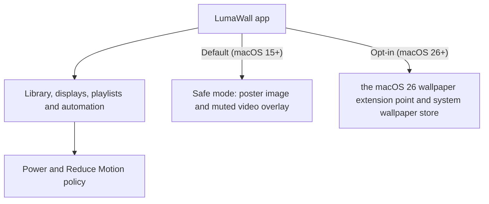

# LumaWall

Play local video files as macOS wallpapers, with per-display assignments,
scheduled playlists, and playback rules for power use and Reduce Motion.

LumaWall is an independent open-source project and is not affiliated with, endorsed by, or sponsored by Apple Inc.

No signed, notarized download is available yet.
See [Build](#build) for setup and [Production DMG](#production-dmg) for distribution requirements.

## Requirements

- macOS 15 or newer for Safe mode (the desktop overlay path, default)
- macOS 26 or newer for the optional extension targeting the macOS 26 wallpaper extension point (`LumaWallWallpaper.appex`)
- Xcode with XcodeGen for the signed app target
- Swift 6 toolchain for library tests

## Product

Import MP4 or MOV. Audio is stripped. Apply to one display or all of them.

Home, Library, Displays, and Settings cover browsing, tags, favorites, recents, and playlists. Day/night and light/dark pairs switch automatically. Automations cover sunrise/sunset (approximate location), weekday masks, do-not-interrupt hours, and power-source rules. Lock screen can take the Idle poster through the native wallpaper store when the system allows it.

Shared overlay decoders reuse one player when the same media hits multiple screens. Reduce Motion freezes to a static frame. Game Mode pauses playback. On battery, a 720p variant can replace the full file. Shortcuts can apply a wallpaper. English and Spanish ship in the string catalog. Settings includes an Energy Log with a 24h sample window for soak checks.

## Safe mode and opt-in native mode

- **Safe mode (default)**: LumaWall uses its desktop overlay engine by default on every macOS version. It sets the desktop image to a static poster for each screen via standard macOS APIs and plays a muted looping video in a desktop-level window above it. It never modifies internal system wallpaper files or restarts system wallpaper agents.
- **Native wallpaper mode (optional, experimental)**: On macOS 26+ with `LumaWallWallpaper.appex` embedded under `Contents/Extensions`, you can opt in to native mode. Native mode uses undocumented interfaces for the macOS 26 wallpaper extension point, deploys the video into the extension container, edits the system wallpaper settings file (`~/Library/Application Support/com.apple.wallpaper/Store/Index.plist`), and restarts `WallpaperAgent` so the system hosts playback.
- **Risk and fallback**: Native mode is used at your own risk and may break after a macOS update. If a native assignment fails, LumaWall falls back to Safe mode (overlay) automatically and can restore your previous wallpaper settings from its backup. Before uninstalling LumaWall or deleting its `Application Support` and container folders, native-mode users should run **Restore original wallpaper** or switch to another wallpaper in System Settings so macOS no longer references the deployed media or backup.

You can also force Safe mode (overlay) from the command line:

```sh
defaults write app.lumawall.personal lumawall.forceOverlay -bool YES
```

## Build

Install the pinned XcodeGen once, then run the checks:

```sh
./ci/bootstrap.sh                     # XcodeGen 2.46.0 into .tools/
./ci/check.sh                         # core tests, app and extension tests, Release build
./ci/test.sh RendererLifecycleTests   # one test class or suite
```

The Xcode project is generated from `project.yml`; regenerate it with
`./ci/xcodegen.sh generate`. Builds land in `.derived`. Building registers
the built wallpaper extension with macOS, which can replace a live
wallpaper from `/Applications/LumaWall.app`. `ci/check.sh` and `ci/test.sh`
unregister the apps they build when they exit. After a raw `xcodebuild`, run
`./ci/unregister-builds.sh`, adding the derived data path if it isn't
`.derived`. See [AGENTS.md](AGENTS.md) for more.

To use a build as your wallpaper, install it to `/Applications/LumaWall.app`.

## Architecture



Safe mode (overlay) and the opt-in native extension are alternative playback paths. Shared playback
reuses a decoder when multiple displays show the same video. Power and
accessibility rules determine when playback pauses or uses a lower-resolution file.

## Update checks

Run `./ci/check.sh` before shipping an update. It runs the core tests and the
rendered playback tests, builds the Release app, and verifies its signature.
Logs and XCTest results are saved under `.derived/checks`.

The playback tests encode temporary videos and check visible, changing frames
on multiple display layers. They cover wallpaper replacement, looping, separate
pause and resume, memory cleanup, and denied native storage access. The `Testing`
configuration uses a separate app identity and does not start the real library,
automations, or wallpaper restore.

GitHub Actions runs the same checks on macOS 15 and 26 for pull requests, changes
to `main`, and version tags. The production release script runs them before it
removes an old package or creates a new archive. A failing test stops packaging.

## Production DMG

The release script deliberately refuses development or ad-hoc identities. Configure
a Developer ID Application certificate and a `notarytool` Keychain profile, then run:

```sh
DEVELOPER_ID_APPLICATION="Developer ID Application: Your Name (TEAMID)" \
DEVELOPMENT_TEAM="TEAMID" \
NOTARY_KEYCHAIN_PROFILE="lumawall-notary" \
./Packaging/release.sh
```

It archives with Hardened Runtime, rejects `get-task-allow`, verifies nested code,
creates `dist/LumaWall.dmg`, submits it to Apple, staples the ticket, and requires a
passing Gatekeeper assessment. A DMG that has not completed every step is not a
production artifact.

## Author

Rijan Ghimire ([Luseefor](https://github.com/Luseefor)).

Project attribution and third-party notices for Phosphene reference code live in `NOTICE` and `THIRD_PARTY_NOTICES.md`.

## License and policies

Licensed under the Apache License, Version 2.0. See [`LICENSE`](LICENSE), [`NOTICE`](NOTICE), [`PRIVACY.md`](PRIVACY.md), [`TERMS.md`](TERMS.md), [`SECURITY.md`](SECURITY.md), and [`CONTRIBUTING.md`](CONTRIBUTING.md).
