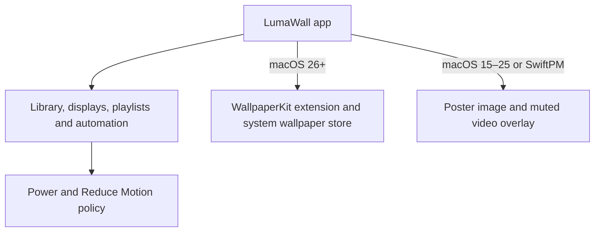

# LumaWall

Play local video files as macOS wallpapers, with per-display assignments,
scheduled playlists, and playback rules for power use and Reduce Motion.

**Build locally:** a signed, notarized download is not available yet.
See [Build](#build) for setup and [Production DMG](#production-dmg) for distribution requirements.

## Requirements

- macOS 15 or newer for the overlay path
- macOS 26 or newer for the embedded WallpaperKit extension (`LumaWallWallpaper.appex`)
- Xcode with XcodeGen for the signed app target
- Swift 6 toolchain for library tests

## Product

Import MP4 or MOV. Audio is stripped. Apply to one display or all of them.

Home, Library, Displays, and Settings cover browsing, tags, favorites, recents, playlists, and day/night or light/dark pairs. Automations cover sunrise/sunset (approximate location), weekday masks, do-not-interrupt hours, and power-source rules. Lock screen can take the Idle poster through the native wallpaper store when the system allows it.

Shared overlay decoders reuse one player when the same media hits multiple screens. Reduce Motion freezes to a static frame. Game Mode pauses playback. On battery, a 720p variant can replace the full file. Shortcuts can apply a wallpaper. English and Spanish ship in the string catalog. Settings includes an Energy Log with a 24h sample window for soak checks.

Force overlay even on a native-capable Mac:

```sh
defaults write app.lumawall.personal lumawall.forceOverlay -bool YES
```

## How apply works

On macOS 26+ with the wallpaper extension embedded under `Contents/Extensions`, LumaWall deploys the video into the extension container and assigns it through the system wallpaper store (`com.apple.wallpaper`). WallpaperAgent hosts playback. Lock-screen live video depends on what the OS allows that day.

On macOS 15–25, or in SwiftPM overlay-only builds, LumaWall sets the desktop image to the poster for that screen and plays a muted looping video over it.

## Build

Library and overlay tests (macOS 15+):

```sh
cd LumaWall
swift build -c release
swift test
```

Native host with the wallpaper appex (macOS 26+):

```sh
cd LumaWall
xcodegen generate
xcodebuild -scheme LumaWall -configuration Release -derivedDataPath .derived build
```

Install the built app to `/Applications/LumaWall.app` for the path this project expects.

## Architecture



The native extension and overlay are alternative playback paths. Shared playback
reuses a decoder when multiple displays show the same video. Power and
accessibility rules determine when playback pauses or uses a lower-resolution file.

## Production DMG

The release script deliberately refuses development or ad-hoc identities. Configure
a Developer ID Application certificate and a `notarytool` Keychain profile, then run:

```sh
DEVELOPER_ID_APPLICATION="Developer ID Application: Your Name (TEAMID)" \
DEVELOPMENT_TEAM="TEAMID" \
NOTARY_KEYCHAIN_PROFILE="lumawall-notary" \
./Packaging/release.sh
```

It archives with Hardened Runtime, rejects `get-task-allow`, verifies nested code,
creates `dist/LumaWall.dmg`, submits it to Apple, staples the ticket, and requires a
passing Gatekeeper assessment. A DMG that has not completed every step is not a
production artifact.

## Author

[Luseefor](https://github.com/Luseefor).

Third-party notices for Phosphene reference code live in `THIRD_PARTY_NOTICES.md`.

## License

This project is licensed under the MIT License. See `LICENSE`.
